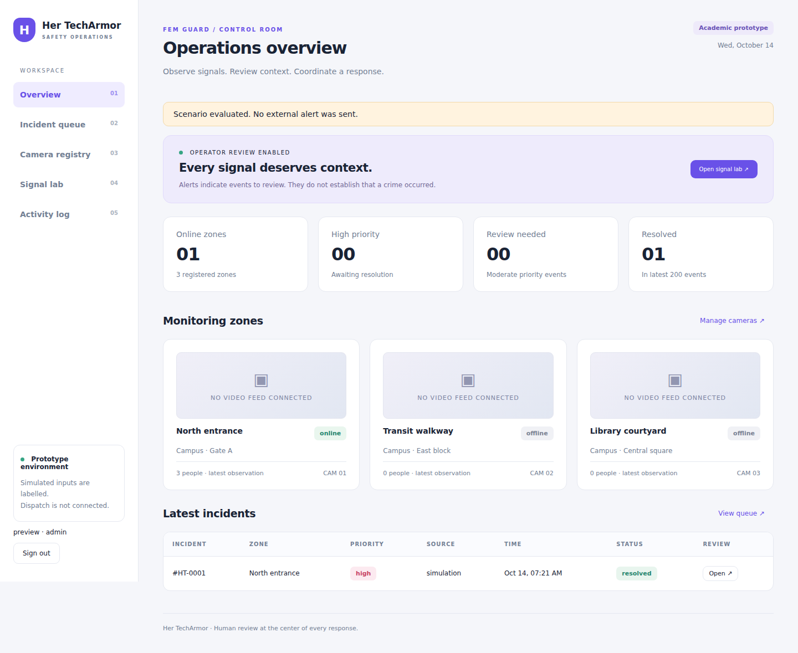

# Her TechArmor · FEM Guard

A human-reviewed safety operations prototype based on five supplied SIH documents. Python/Flask, SQLite and a responsive browser UI. **Academic MVP: no emergency dispatch or trained distress recognition is connected.**



## Implemented

- Password-hashed admin/operator login, CSRF, basic account lockout, security headers.
- Camera registry, enable/disable, observation heartbeat and latest people count.
- Clearly labelled simulation lab for gesture, scream, aggression and manual SOS.
- Explainable priority policy, repeated-alert coalescing, incident review notes.
- Open → acknowledged → resolved workflow, activity log, metadata export with SHA-256.
- Authenticated device API and optional real webcam/video **people-count baseline**.
- Docker, CI, tests, Windows setup and complete design/API/model documentation.

Not implemented: trained scream/gesture/aggression recognition, gender/emotion inference, web CCTV streaming, media evidence storage, police dispatch, external notifications, maps, hotspot prediction or immutable storage. Scores in the lab are synthetic. The optional HOG worker counts people only.

## Windows / VS Code setup

Use Python 3.11 or 3.12. Open a terminal in this project folder:

```powershell
py -m venv .venv
.\.venv\Scripts\Activate.ps1
python -m pip install -r requirements.txt
python -m flask --app techarmor init-db
python -m flask --app techarmor create-user --username admin --role admin
python -m flask --app techarmor seed-demo
python -m flask --app techarmor run --host 127.0.0.1 --port 8080
```

Enter a password of at least 12 characters when prompted. Open **http://127.0.0.1:8080**. If activation is blocked, use `.venv\Scripts\python.exe` instead of `python`. No default account/password is shipped. On Linux/macOS use `python3 -m venv .venv` and `source .venv/bin/activate`, then the same Python commands.

## Demo walkthrough

1. Sign in and inspect three offline demo zones. These are registry entries without live feeds.
2. Open Signal lab, select a zone, load the distress example and evaluate it.
3. Open the resulting high priority incident. Acknowledge with a note, then resolve with another note.
4. Export the metadata JSON and inspect the activity log.
5. Test scream 0.90 alone for moderate priority, or low values for heartbeat without an incident.
6. Manual SOS creates high priority independently of other values. No external alert is sent.

## Optional actual webcam / video person counting

```powershell
python -m pip install -r requirements-vision.txt
$env:DEVICE_TOKEN = "your-random-device-token"
python -m flask --app techarmor run --host 127.0.0.1 --port 8080
```

In a second activated terminal, set the same token and run:

```powershell
$env:DEVICE_TOKEN = "your-random-device-token"
python scripts/vision_worker.py --source 0 --camera-id 1
# Or use a local, consented video file:
python scripts/vision_worker.py --source "C:\videos\demo.mp4" --camera-id 1
```

Press Q in the local preview to stop. The browser shows counts and heartbeat, not video. HOG is a limited pretrained CPU baseline; occlusion, small people, camera angle and low light reduce quality. It does not infer gender, emotion, screams or help gestures. People counts do not determine danger.

## Serving, data and configuration

```powershell
python -m waitress --host=127.0.0.1 --port=8080 --call techarmor:create_app
```

`instance/` holds SQLite and a generated session key and is excluded from Git. Back it up while the app is stopped. `init-db` does not delete existing data. No automatic retention job exists. Environment variables are read from your shell; `.env.example` is a reference, not automatically loaded by Flask. `SECRET_KEY` overrides the local generated key. `DEVICE_TOKEN` enables device ingestion; unset means all device submissions are rejected. Set `COOKIE_SECURE=1` when served over HTTPS.

## Docker

Copy `.env.example` to `.env` and replace both secrets. For local HTTP keep COOKIE_SECURE=0.

```bash
docker compose build
docker compose run --rm console python -m flask --app techarmor init-db
docker compose run --rm console python -m flask --app techarmor create-user --username admin --role admin
docker compose run --rm console python -m flask --app techarmor seed-demo
docker compose up -d
```

Open http://127.0.0.1:8080. A named volume preserves data. Compose reads `.env`. Public deployment requires TLS, device provisioning, stronger rate limits, monitoring, backups and reviewed retention.

## Tests and structure

```bash
python -m pip install -r requirements-dev.txt
python -m pytest -q
python -m ruff check .
```

- `techarmor/`: application factory, policy, templates, CSS and JS.
- `tests/`: policy/security/API integration tests.
- `scripts/vision_worker.py`: optional people-count adapter.
- `docs/PROJECT_DOCUMENTATION.md`: complete idea, architecture, requirements and roadmap.
- `docs/SOURCE_ANALYSIS.md`: comparison and traceability for all five documents.
- `docs/API.md`, `docs/MODEL_PLAN.md`, `docs/VALIDATION.md`: interfaces, future model work and actual validation.
- `.github/workflows/ci.yml`: tests and lint on push/pull request.

## GitHub upload

Create an empty repository called `her-techarmor`, then run:

```bash
git init
git add .
git commit -m "Initial Her TechArmor operations MVP"
git branch -M main
git remote add origin https://github.com/YOUR_USERNAME/her-techarmor.git
git push -u origin main
```

Replace YOUR_USERNAME and review staged files. Do not publish secrets or personal footage. This package has not been pushed to your account. Project-authored code uses MIT; original presentations and third-party datasets/models are not covered by that license.
