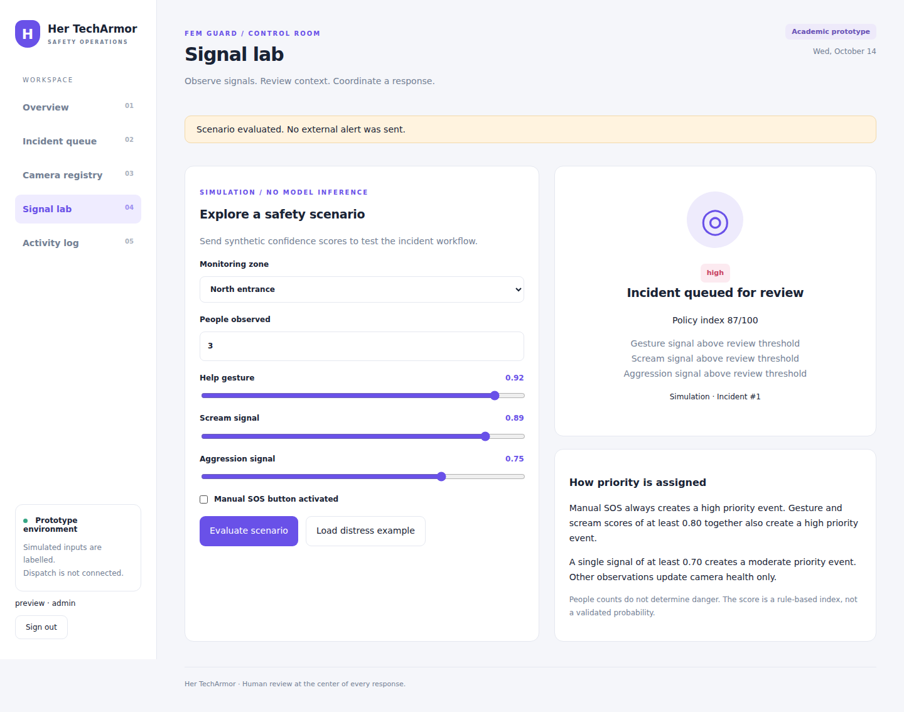
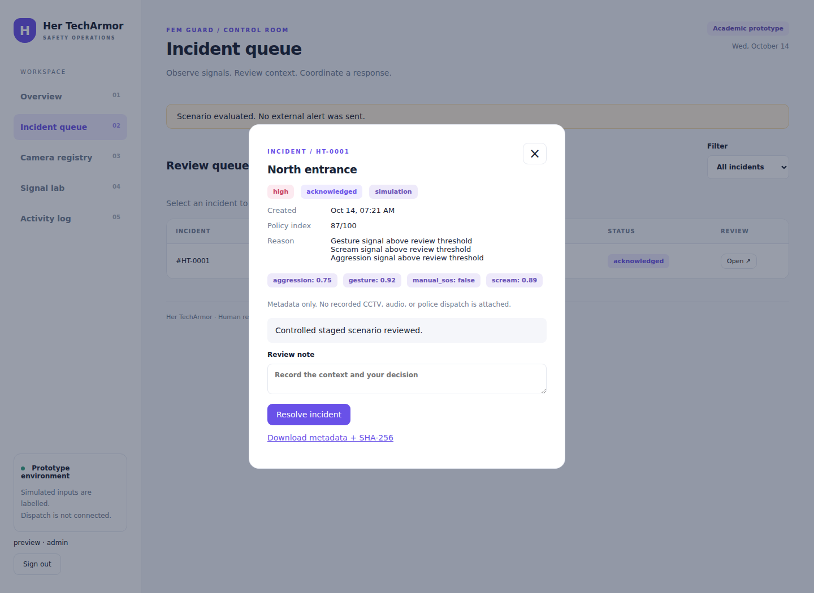
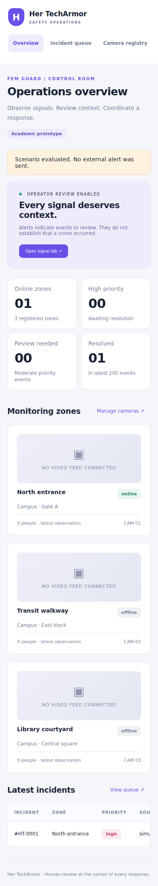
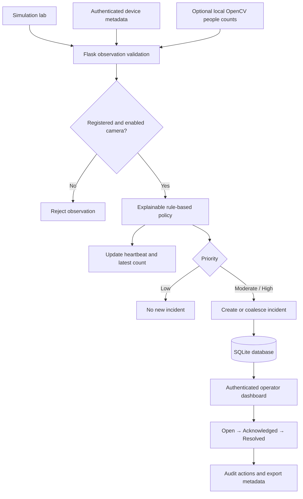
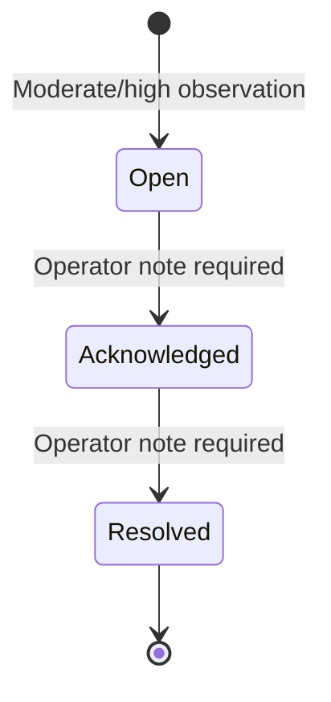

<div align="center">

# 🛡️ FEM Guard
### Her TechArmor — Multimodal Safety Monitoring & Human-Reviewed Incident Management

**An explainable, human-in-the-loop safety operations prototype for campus and public-space monitoring.**

    

**Project:** Her TechArmor · **Application:** FEM Guard · **Release:** v0.1 (October 2026)

[Features](#-implemented-features) · [Architecture](#-system-architecture) · [Installation](#-quick-start) · [API](#-api-reference) · [Roadmap](#-roadmap) · [Documentation](#-documentation)

</div>

> [!IMPORTANT]
> **Academic prototype — not an emergency response service.** This version supports simulated distress-signal evaluation and a working operator review workflow. It **does not** implement trained gesture/scream/aggression recognition, real-time web CCTV, police dispatch, external emergency notifications, or video/audio evidence storage. Its optional OpenCV worker performs **people counting only**. No real-world detection accuracy or safety outcome is claimed.

## 📖 Overview

**Her TechArmor / FEM Guard** explores how existing monitoring environments can move from passive footage observation to an **explainable incident-review workflow**. Rather than asserting that automated signals prove danger, the platform brings candidate observations to authorized human operators, who can acknowledge, investigate, document, and resolve incidents.

The concept is informed by the supplied **SIH1605 — Women Safety Analytics: Protecting Women from Safety Threats** project materials. The delivered software accepts distress or SOS inputs for **any person**; it does not classify gender, identity, or facial emotion.

The proposed full system combines **temporal help gestures**, **acoustic distress**, **manual SOS**, and camera context. The current release implements the application, observation interface, deterministic priority policy, and review process while keeping untrained AI capabilities clearly marked as future work.

## 🎯 Problem & Objectives

Traditional CCTV review often requires operators to watch multiple camera views or examine recordings after an event. Ambiguous behavior, background noise, varying visibility, and workload make consistent triage difficult.

FEM Guard aims to:

- Surface **reviewable candidate incidents** rather than issue unsupported crime predictions.
- Combine independent gesture, audio, and SOS candidates in a transparent **priority policy**.
- Preserve a **direct manual SOS route**, even if other signals are absent.
- Reduce repeated automatic incident entries within a short time window.
- Support **accountable operator decisions**, review notes, and audit history.
- Provide a documented interface for future **validated AI inference adapters**.

## ✨ Implemented Features

| Module | Available in v0.1 |
|---|---|
| Secure sign-in | Admin/operator accounts, salted password hashes, CSRF protection, session controls and basic login lockout |
| Operations dashboard | Registered zones, heartbeat freshness, unresolved priorities, recent incidents |
| Camera/zone registry | Administrator-managed zone creation and enable/disable controls |
| Signal lab | Clearly marked **synthetic** gesture, scream, aggression and manual-SOS inputs |
| Rule-based fusion | Explainable **low / moderate / high** priority with reasons |
| Incident queue | Review and filter incidents; acknowledgement and resolution require notes |
| Alert coalescing | Reuse qualifying repeated automatic alerts within **60 seconds**; manual SOS is never coalesced |
| Activity audit | Records account, camera, incident and export actions |
| Metadata export | Authenticated JSON download with SHA-256 consistency checksum; **no audiovisual footage** |
| Device ingestion | Bearer-token-protected metadata observation endpoint |
| Optional computer vision | Local OpenCV HOG/SVM **person-count baseline**, with count updates and preview |
| Developer delivery | Tests, CI, Docker, local WSGI serving, model/API/security documentation |

## 🖥️ Interface Preview

**Operations overview**


**Signal simulation lab**



**Incident review**



**Responsive mobile interface**



## 🏗️ System Architecture



**Current stack:** Python 3.11/3.12, Flask 3.1.2, SQLite, server-rendered HTML, CSS, JavaScript, Waitress, optional OpenCV, Docker Compose, pytest, Ruff, and GitHub Actions. Browser state is refreshed approximately every five seconds. The UI requires no CDN or paid AI API.

## 🧠 Explainable Priority Policy

The signal lab and device API accept values from `0.0` to `1.0` for three candidate signals. In v0.1 these values are **demonstration inputs**, not outputs of trained distress classifiers.

```text
If manual_sos = true:
    HIGH priority; index = 100
Else if gesture >= 0.80 AND scream >= 0.80:
    HIGH priority
Else if gesture >= 0.70 OR scream >= 0.70 OR aggression >= 0.70:
    MODERATE priority
Else:
    LOW priority; update observation heartbeat without creating an incident
```

**Display index** (a weighted demonstration score):

```text
index = round(100 × (0.40 × gesture + 0.35 × scream + 0.25 × aggression))
```

The index is **not** a calibrated likelihood of harm. Priority is determined by the above corroboration rules, not a score cutoff. A high-priority event may have an index below 80. People counts do **not** trigger danger alerts.

| Example | Result |
|---|---|
| Manual SOS, no other signal | High, index 100, distinct incident |
| Gesture 0.92 + scream 0.89 + aggression 0.75 | High, index 87 |
| Scream 0.90 alone | Moderate |
| All signals below 0.70, no SOS | Low; heartbeat update only |

## 🔄 Incident Lifecycle



An incident records camera/zone, source, priority, index, original candidate scores, explanation, timestamps, status and the latest review note. Notes must contain **3–1000 characters**. Earlier actions remain in the audit log. Direct `open → resolved` transitions and reopening are not permitted.

Qualifying automatic observations from the same camera, source, and priority can reuse an open incident within **60 seconds**. Manual SOS always creates a new incident. These controls are workflow behavior, not verified emergency performance.

## 🚀 Quick Start

### Requirements

- **Python 3.11 or 3.12** (validated on Python 3.12)
- `pip`, a terminal and modern web browser
- Optional: webcam/local video for the OpenCV baseline
- Optional: Docker and Docker Compose

### Windows / PowerShell

Extract the project ZIP, open the **`her-techarmor`** folder (the folder containing `requirements.txt`), and run:

```powershell
py -m venv .venv
.\.venv\Scripts\Activate.ps1
python -m pip install -r requirements.txt
python -m flask --app techarmor init-db
python -m flask --app techarmor create-user --username admin --role admin
python -m flask --app techarmor seed-demo
python -m flask --app techarmor run --host 127.0.0.1 --port 8080
```

Enter a password of **at least 12 characters** when prompted. The repository ships with **no default user or password**. If PowerShell blocks activation, run commands with `.\.venv\Scripts\python.exe` in place of `python`.

### Linux / macOS

```bash
python3 -m venv .venv
source .venv/bin/activate
python -m pip install -r requirements.txt
python -m flask --app techarmor init-db
python -m flask --app techarmor create-user --username admin --role admin
python -m flask --app techarmor seed-demo
python -m flask --app techarmor run --host 127.0.0.1 --port 8080
```

Open **http://127.0.0.1:8080** and sign in with the account you created. `seed-demo` creates demonstration zones; these are **not live CCTV feeds**.

### Guided Demo

1. Sign in and view the zones and recent incident summary on **Overview**.
2. Select **Signal lab**, choose an enabled zone, and load the example distress scenario.
3. Evaluate the synthetic scores to generate a high-priority candidate incident.
4. Open **Incident queue**, acknowledge the event with a note, then resolve it with another note.
5. Download the JSON incident metadata from the incident review and inspect **Activity log**.
6. Try a single scream score of `0.90`, lower scores, and manual SOS to compare behavior.

**No emergency dispatch or external contact occurs during the demo.**

## 📷 Optional OpenCV People-Counting Worker

Install optional vision dependencies:

```powershell
python -m pip install -r requirements-vision.txt
```

Set a **matching private** device token for the server and worker. In a PowerShell server terminal:

```powershell
$env:DEVICE_TOKEN = "replace-with-a-long-random-secret"
python -m flask --app techarmor run --host 127.0.0.1 --port 8080
```

In a second terminal with the virtual environment active:

```powershell
$env:DEVICE_TOKEN = "replace-with-a-long-random-secret"
python scripts/vision_worker.py --source 0 --camera-id 1
```

For an authorized, local video instead:

```powershell
python scripts/vision_worker.py --source "C:\videos\demo.mp4" --camera-id 1
```

Press **Q** to exit the local preview. This adapter uses pretrained OpenCV HOG/SVM and sends counts approximately every three seconds. It does **not** perform gesture, scream, aggression, face, identity or gender recognition. Results depend on camera angle, occlusion, distance and lighting. Use consented or otherwise appropriately authorized footage.

## 🧩 API Reference

Default base URL: `http://127.0.0.1:8080`. Browser mutations require a logged-in session and `X-CSRF-Token`. The separate device observation endpoint requires `Authorization: Bearer <DEVICE_TOKEN>`. JSON request bodies have a **64 KiB** maximum.

| Method | Endpoint | Access / Description |
|---|---|---|
| `GET` | `/health` | Public server liveness (not model readiness) |
| `GET` | `/api/state` | Operator/admin: zone, incident and activity state |
| `POST` | `/api/cameras` | Admin + CSRF: create zone |
| `PATCH` | `/api/cameras/{id}` | Admin + CSRF: enable/disable zone |
| `POST` | `/api/simulate` | Operator/admin + CSRF: synthetic observation |
| `POST` | `/api/observations` | Bearer token: device metadata observation |
| `PATCH` | `/api/incidents/{id}` | Operator/admin + CSRF: acknowledge/resolve with note |
| `GET` | `/api/incidents/{id}/export` | Operator/admin: download metadata and checksum |

**Observation example**

```json
{
  "camera_id": 1,
  "people": 3,
  "gesture": 0.92,
  "scream": 0.89,
  "aggression": 0.75,
  "manual_sos": false
}
```

`camera_id` must name an enabled zone. `people` is an integer between `0` and `10000`. Candidate signals are finite numeric values between `0` and `1`; `manual_sos` must be a boolean. Missing scores default to zero. This sample results in **high** priority and index **87**.

**Device API example (Python standard library)**

```python
import json
import os
import urllib.request

payload = {"camera_id": 1, "people": 3, "manual_sos": True}
request = urllib.request.Request(
    "http://127.0.0.1:8080/api/observations",
    data=json.dumps(payload).encode("utf-8"),
    headers={
        "Content-Type": "application/json",
        "Authorization": "Bearer " + os.environ["DEVICE_TOKEN"],
    },
)
with urllib.request.urlopen(request, timeout=5) as response:
    print(response.read().decode("utf-8"))
```

**Review transition examples** (authenticated browser request + CSRF):

```json
{"status":"acknowledged","note":"Reviewed staged event."}
```

```json
{"status":"resolved","note":"Staged review closed after verification."}
```

See [`docs/API.md`](docs/API.md) for validation rules, authorization and error responses.

## 🔐 Security, Privacy & Evidence Boundaries

- Roles are **admin** and **operator**; zone registry changes require administrator authorization.
- Passwords use salted Werkzeug hashes; sessions expire after eight hours.
- HTTP-only, SameSite Strict cookies and CSRF checks protect browser actions. Five failed logins temporarily block an account for five minutes.
- Device submissions require a distinct bearer token; no default credentials are provided.
- Browser UI does not accept arbitrary remote camera URLs or camera passwords.
- SQLite stores operational metadata; **raw CCTV/audio, identity embeddings, and gender labels are not stored**.
- Metadata export includes a SHA-256 checksum of canonical JSON, useful for consistency checking **but not proof of tamper resistance or evidentiary authenticity**.
- The project does **not** currently encrypt the database at the application level, implement automatic record deletion, immutable media retention or centralized MFA.
- Before any real deployment, implement approved data governance, retention, per-device credentials, secure transport, access review, monitoring, and backup/recovery processes.

For vulnerability reporting guidance see [`SECURITY.md`](SECURITY.md). Never commit `.env`, `instance/`, credentials or personal footage.

## 🐳 Docker / Local Serving

Copy `.env.example` to `.env` and replace the placeholder secrets. For local HTTP set `COOKIE_SECURE=0`; behind properly configured HTTPS set `COOKIE_SECURE=1`.

```bash
docker compose build
docker compose run --rm console python -m flask --app techarmor init-db
docker compose run --rm console python -m flask --app techarmor create-user --username admin --role admin
docker compose run --rm console python -m flask --app techarmor seed-demo
docker compose up -d
```

The included Compose configuration binds to **localhost**; it is not a ready-made public deployment. A named volume persists state. Alternatively serve locally through Waitress:

```bash
python -m waitress --host=127.0.0.1 --port=8080 --call techarmor:create_app
```

The application reads environment variables from the shell; Flask does **not** automatically load `.env.example`. `SECRET_KEY` can override the generated local key. `DEVICE_TOKEN` must be set to enable device ingestion. `instance/` contains local state and is ignored by Git.

## 🗂️ Repository Structure

```text
her-techarmor/
├── techarmor/
│   ├── __init__.py              # Flask app, API, authentication and persistence
│   ├── risk.py                  # Explainable priority policy
│   ├── templates/              # Login, dashboard and error pages
│   └── static/                 # Responsive CSS and browser JavaScript
├── scripts/
│   └── vision_worker.py        # Optional OpenCV HOG people-count adapter
├── tests/
│   └── test_app.py             # Application/API/security test coverage
├── docs/
│   ├── PROJECT_DOCUMENTATION.md
│   ├── HER_TECHARMOR_Project_Documentation.pdf
│   ├── SOURCE_ANALYSIS.md
│   ├── SOURCE_EXTRACTS.txt
│   ├── MODEL_PLAN.md
│   ├── API.md
│   ├── VALIDATION.md
│   └── ui-*.png                 # Desktop, mobile, lab, incident screenshots
├── .github/workflows/ci.yml
├── Dockerfile
├── compose.yaml
├── requirements.txt
├── requirements-dev.txt
├── requirements-vision.txt
├── pyproject.toml
├── .env.example
├── SECURITY.md
├── CONTRIBUTING.md
├── LICENSE
└── README.md
```

## ✅ Tests & Validation

Run locally:

```bash
python -m pip install -r requirements-dev.txt
python -m pytest -q
python -m ruff check .
```

**Recorded validation on 14 October 2026:** nine pytest tests passed on Python 3.12; configured Ruff checks passed; a headless Chromium login → synthetic high incident → acknowledge → resolve flow succeeded; desktop (1440px) and mobile (390px) interface smoke checks passed. OpenCV HOG initialized and processed a blank test frame. Docker and CI definitions were supplied but not executed during that validation; Windows instructions were not tested in the reported Linux environment. **These results do not measure real distress-recognition accuracy.** See [`docs/VALIDATION.md`](docs/VALIDATION.md).

## 🗺️ Roadmap

| Phase | Development goal | Status |
|---|---|---|
| 1 | Authentication, registry, signal simulation, priority and review console | ✅ Implemented |
| 2 | Local OpenCV people-count baseline | ✅ Optional baseline |
| 3 | Consented data, labelled temporal gestures and audio; independently evaluated CNN/LSTM/TCN and acoustic candidates | 📋 Planned |
| 4 | Timestamped multimodal fusion, calibration, model/device provenance and replay protection | 📋 Planned |
| 5 | Authorized evidence clips, policy-controlled retention and operator-approved responder notifications | 📋 Planned |
| 6 | Supervised pilot, independent evaluation, scale/availability and recovery testing | 📋 Planned |

For future model research, evaluate **precision, recall, F1, PR-AUC, false alerts per camera-hour, missed episodes, alert delay**, and robustness to lighting, occlusion and audio noise. No performance figure is claimed for the current release. See [`docs/MODEL_PLAN.md`](docs/MODEL_PLAN.md).

## 📚 Documentation

- [Full project documentation](docs/PROJECT_DOCUMENTATION.md) — project idea, requirements, modules, architecture, privacy, evaluation and plan.
- [Project documentation (PDF)](docs/HER_TECHARMOR_Project_Documentation.pdf) — formatted report and interface walkthrough.
- [Original source comparison](docs/SOURCE_ANALYSIS.md) — traceability across the five supplied proposal files.
- [API specification](docs/API.md) — endpoint contracts, payloads and verification.
- [Model development plan](docs/MODEL_PLAN.md) — research milestones and readiness criteria.
- [Validation notes](docs/VALIDATION.md) — tests and smoke-check boundaries.
- [Contribution guidelines](CONTRIBUTING.md) · [Security](SECURITY.md) · [MIT license](LICENSE)

## 🤝 Contribution & Responsible Use

Improvements to accessibility, software testing, careful false-alert evaluation, privacy safeguards and operator workflow are welcome. Please consult [`CONTRIBUTING.md`](CONTRIBUTING.md) before contributing. Only use appropriately consented or licensed recordings, and do not publish sensitive observation data.

This prototype supports **human judgment**; it does not establish that a crime has occurred, identify perpetrators, or replace emergency reporting. Any field deployment requires institutional authorization, tested procedures, trained reviewers and an independent emergency channel.

## 📄 License

The project-authored application code is distributed under the [MIT License](LICENSE). Original reference presentations, third-party models, datasets and recordings are **not** automatically included under that license.

---

<div align="center">

**FEM Guard · Her TechArmor**  
*Building explainable, human-reviewed safety monitoring systems.*

</div>
